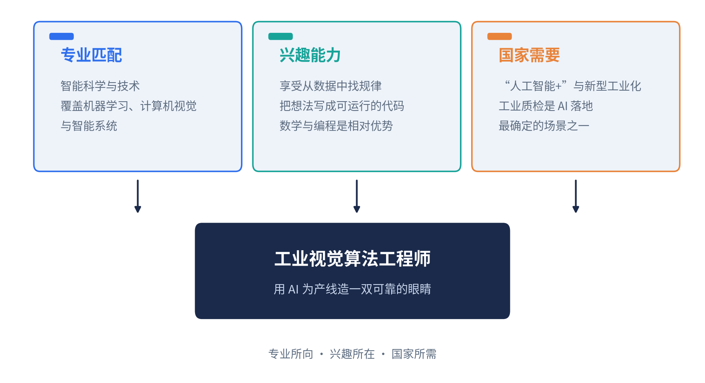
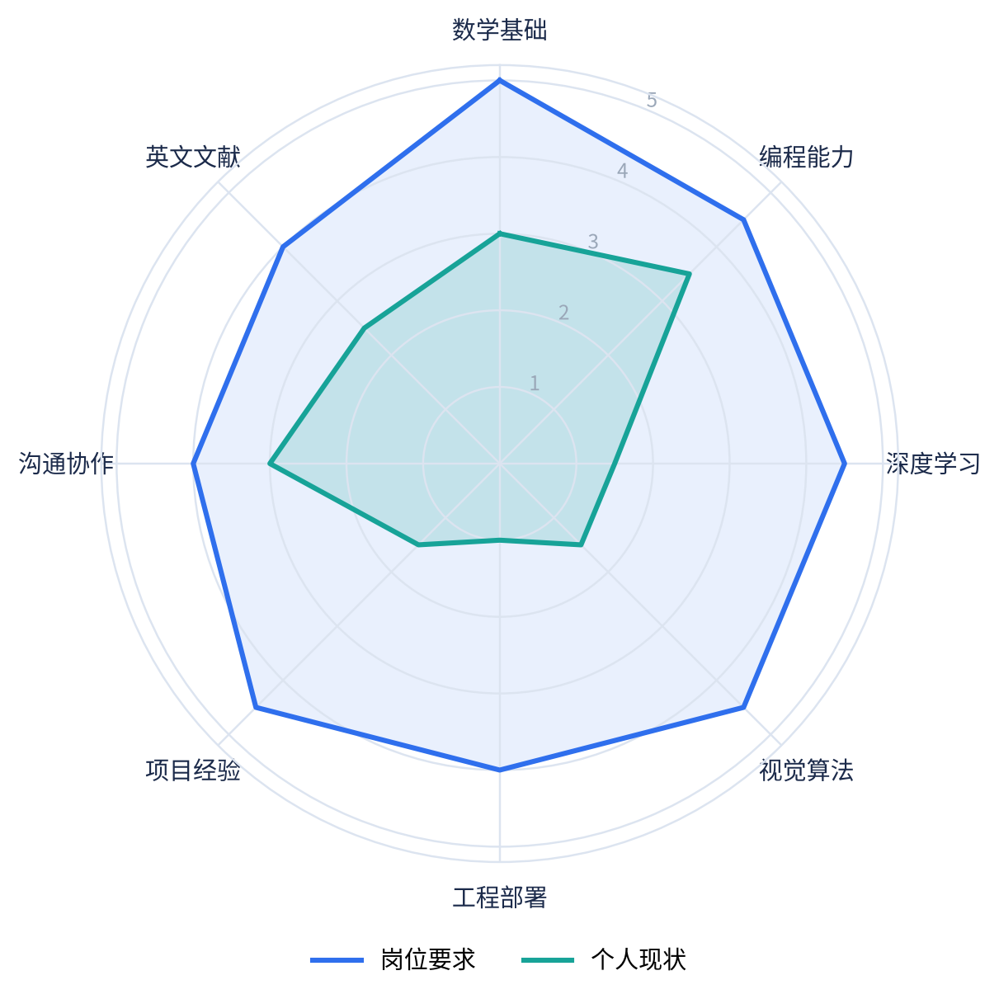
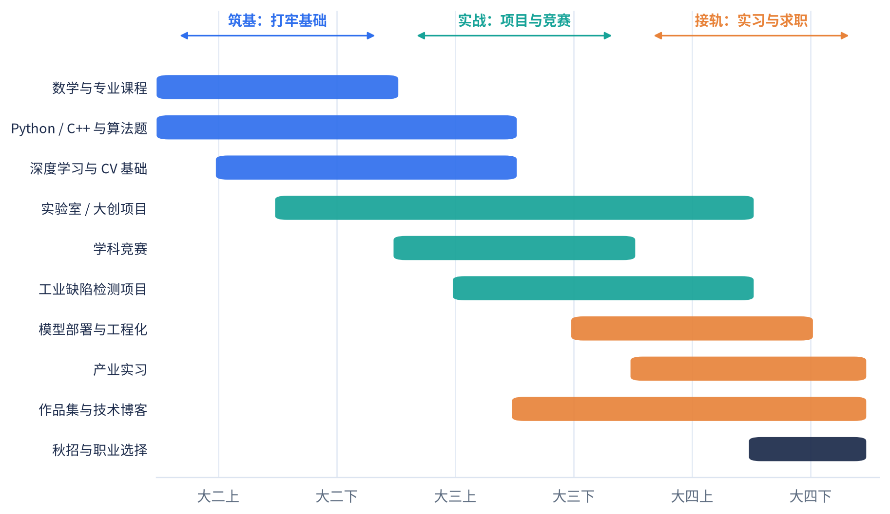
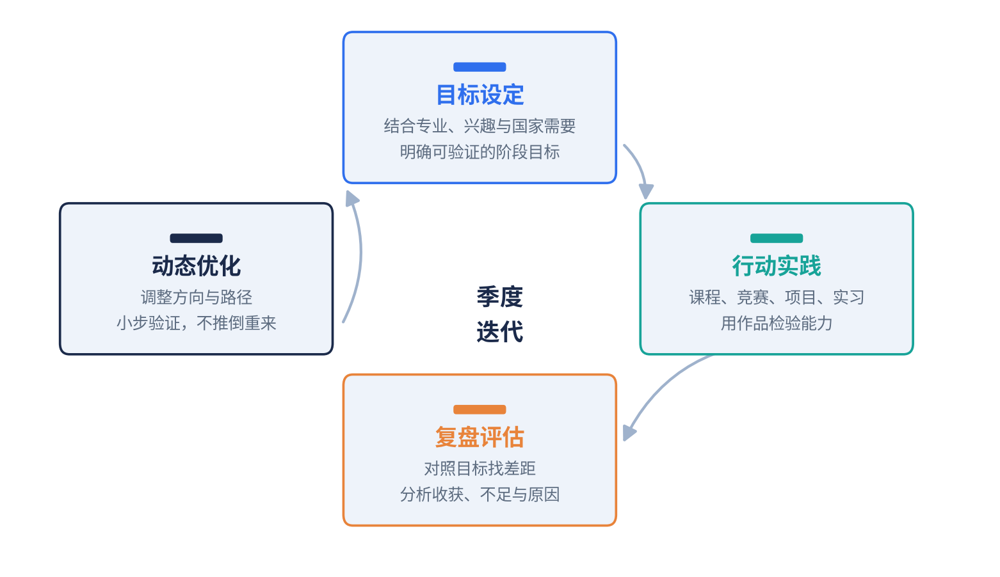

# 从“看得见”到“看得懂”
## ——我的工业视觉算法工程师成长规划

| 姓名 | 【你的姓名】 |
| --- | --- |
| 学校 | 【学校名称】 |
| 专业 | 智能科学与技术 |
| 年级 | 大二 |
| 目标职业 | 工业视觉算法工程师 |

## 一、职业目标：让机器看懂中国制造的“瑕疵”

我是【学校】智能科学与技术专业大二学生。刚入学时，我用一行代码让电脑识别出手写数字，第一次感受到“让机器看懂世界”的魅力；后来在【课程/讲座/企业参访】中了解到，我国制造业质检环节仍大量依赖人工，漏检率与用工成本居高不下。专业所向、兴趣所在与国家所需在这里交汇，我把职业目标确定为：工业视觉算法工程师——用计算机视觉技术为产线打造更可靠的“眼睛”。

这一选择有三重依据。专业上，智能科学与技术覆盖机器学习、计算机视觉与智能系统，与岗位知识结构高度契合；能力与兴趣上，我享受从数据中找规律、把想法写成可运行代码的过程，数学与编程是我的相对优势；价值上，“人工智能+”与新型工业化正在持续推进，工业质检是AI落地最确定的场景之一，个人成长能够与产业升级同频。

为验证目标，我分析了【招聘平台】上30份岗位JD，访谈了【2】位从业学长，并研读【行业报告】：初级算法工程师需掌握Python/C++、深度学习框架、主流视觉模型与模型部署，能与工艺、设备团队协作；典型成长路径为算法工程师→高级算法工程师→技术专家或技术负责人。

## 二、学习实践行动：把差距拆成可执行的任务

对照岗位要求，我从知识、能力、素养三个维度做了差距分析（图2）：线代、概率与最优化需要夯实，深度学习与视觉尚未系统学习；缺少完整项目、代码规范与部署经验；技术表达与团队协作也有提升空间。

据此，我制定了三年行动路线（图3）。

大二上至大二下，筑基。系统学习机器学习与深度学习课程，跟完《动手学深度学习》并复现LeNet、ResNet；每周完成3道算法题，打牢Python与C++；加入【实验室/导师课题组】，从数据标注与实验记录做起。目标是绩点进入【前20%】，独立完成一个图像分类项目并开源。

大二下至大三上，实战。参加【智能车/挑战杯/计算机大赛】，在真实约束中打磨工程能力；围绕工业缺陷检测，使用MVTec AD数据集完成“数据增强—模型训练—TensorRT部署”闭环；掌握Git、Linux、Docker。目标是获得省级以上奖项1项、形成可展示项目2个。

大三下至大四，接轨产业。投递工业视觉算法实习，进入真实产线；顺应大模型趋势，补充多模态与视觉大模型微调能力；沉淀技术博客与作品集，备战秋招。

资源上，我主动争取四类支持：用好学校实验室GPU、导师指导与校企合作项目；以赛代练、以赛促学；参与开源社区与校内技术社团，向学长学姐请教；通过企业参访、实习与线上课程理解真实需求。

行动中我也遇到困难。【示例：数学分析课程吃力，我组建三人学习小组每周互讲，成绩从78分提升到92分；首次训练模型时显存不足，我查阅文档，改用混合精度与梯度累积，在单卡上跑通训练。】这些经历让我明白，困难不是放弃的理由，而是调整方法的信号。

目前已有阶段性成果：【课程项目“垃圾图像分类”准确率93%；竞赛××奖；社团技术部负责人；GitHub项目链接】。与起点相比，我在知识结构、工程规范和自我管理上都有了可见的成长。

## 三、优化改进：让规划在变化中生长

我建立了季度复盘机制：对照目标检查进度，用“继续做、停止做、开始做”三栏记录反思。第一次复盘，我发现时间多花在囤课上、项目推进缓慢，于是把“学完一门课”改成“两周产出一个小作品”，效率明显提升。

第二次调整来自兴趣澄清。我曾同时尝试NLP与CV，精力分散；通过【图像项目/实验室任务】，我确认自己更享受视觉任务“数据—模型—结果”的即时反馈，于是收敛方向，聚焦工业视觉。

第三次调整来自行业变化。大模型正在重构算法岗位的能力结构，我把多模态与视觉大模型加入学习清单，将目标从“单一检测算法”拓展为“检测+多模态理解”的复合能力。若未来需求再变，我会沿用同一方法：先调研、再小步验证、最后调整路径，而不是推倒重来。

职业规划不是一次写好的答案，而是一套持续迭代的方法。我的愿景是成为既懂算法又懂产线的工业视觉专家，用技术让中国制造“看得更清、检得更准”。我将以季度为周期，把今天的规划变成明天的能力。
